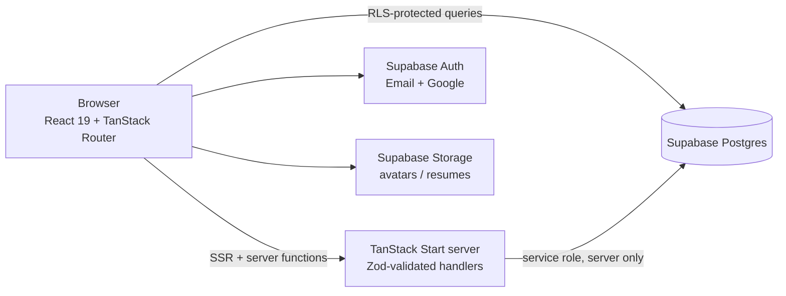

<div align="center">

# 🎓 PlacementCamp

**A full-stack campus placement preparation platform for engineering students in India.**

DSA roadmaps · Timed aptitude tests · Daily challenges · Peer interview experiences · Admin CMS


</div>

---

## Overview

PlacementCamp gives students one place to prepare for campus hiring: structured DSA roadmaps with progress tracking, timed aptitude practice graded on the server, a daily challenge, and a moderated library of real interview experiences. Admins get a role-guarded CMS to manage all content, bulk-import questions from CSV, moderate submissions and review an audit trail.

## Features

### 👩‍🎓 Student app
| Area | What it does |
|---|---|
| **Dashboard** | Live progress across roadmaps, aptitude and daily challenges |
| **DSA Roadmap** | Roadmap → modules → topics → problems, with per-problem status (not started / in progress / completed) |
| **Aptitude** | Randomised timed quizzes per topic, full-length tests, attempt history and answer review |
| **Daily Challenge** | One question a day with recorded attempts |
| **Interview Experiences** | Browse and filter by company and outcome; submit and edit your own (moderated) |
| **Video Library** | Curated YouTube lessons with watch-progress tracking |
| **Profile** | Bookmarks, profile editing, avatar and resume upload |

### 🛠️ Admin panel
| Area | What it does |
|---|---|
| **Content CMS** | CRUD for roadmaps, modules, topics, problems, aptitude questions/tests, daily challenges and videos |
| **Bulk import** | CSV import for roadmaps and aptitude question banks |
| **Moderation** | Approve / reject interview experiences and experience reports |
| **Inbox** | Contact-form messages |
| **Audit log** | Every admin content change, with actor, entity and details |

## Architecture



- **Client reads** go straight to Supabase and are protected by Row Level Security.
- **Sensitive operations** (quiz serving and grading, rate limiting, contact form) run in TanStack Start **server functions** with Zod-validated input and the service-role key, which never reaches the browser.

## Security design

- **Row Level Security on every table**, with explicit `GRANT`s per role
- **Role model:** `app_role` enum (`admin`, `student`) with a `has_role()` security-definer function; every new profile gets `student` via trigger, and a guard trigger stops any client session from granting `admin`
- **Answers never leave the server:** students cannot read `correct_index`; quizzes are served without answers and graded server-side
- **Rate limiting** per IP and per email on login, signup, password reset and the contact form (`src/lib/rate-limit.server.ts`)
- **Tamper-proof audit log:** RLS only accepts audit rows from an admin whose id matches `actor_id`
- **Private storage buckets** for avatars and resumes, scoped to each user's folder

## Data model

23 tables across 8 versioned SQL migrations (`drizzle/migrations`):

| Domain | Tables |
|---|---|
| Users & roles | `profiles`, `user_roles`, `notifications` |
| DSA | `roadmaps`, `modules`, `topics`, `problems`, `student_problem_progress` |
| Aptitude | `aptitude_topics`, `aptitude_questions`, `aptitude_attempts`, `aptitude_tests`, `aptitude_test_questions` |
| Daily | `daily_challenges`, `daily_challenge_attempts` |
| Community | `interview_experiences`, `experience_reports`, `bookmarks` |
| Learning | `video_resources`, `video_progress` |
| Platform | `admin_audit_logs`, `contact_messages`, `rate_limits` |

## Tech stack

| Layer | Technology |
|---|---|
| Framework | TanStack Start (SSR, file-based routing, server functions) |
| UI | React 19, Tailwind CSS v4, shadcn/ui (Radix), Recharts, Lucide |
| Validation | Zod (client forms and every server-function input) |
| Data fetching | TanStack Query |
| Backend | Supabase — PostgreSQL, Auth, Storage |
| Migrations | Versioned SQL (drizzle-kit) |
| Tooling | Vite, TypeScript, ESLint, Prettier, Bun |

## Getting started

**Prerequisites:** Node.js 20+ (or Bun) and a [Supabase](https://supabase.com) project.

```sh
git clone https://github.com/MagbulBasha2/PLACEMENTCAMP.git
cd PLACEMENTCAMP
cp .env.example .env        # fill in your Supabase URL and keys
npm install
npm run dev                 # http://localhost:3000
```

**Database:** run the SQL files in `drizzle/migrations` against your Supabase database in order (`0000` → `0007`).

**Google sign-in (optional):** enable the Google provider in Supabase → Authentication → Providers.

| Script | Purpose |
|---|---|
| `npm run dev` | Start the dev server |
| `npm run build` | Production build |
| `npm run preview` | Preview the production build |
| `npm run lint` | ESLint |
| `npm run format` | Prettier |

## Project structure

```
src/
├── routes/
│   ├── index.tsx              # Landing page
│   ├── auth.tsx               # Sign in / sign up
│   └── _authenticated/        # Signed-in student app
│       ├── dashboard.tsx
│       ├── roadmap.tsx
│       ├── aptitude/          # Quizzes, tests, history
│       ├── experiences/       # Interview experiences
│       └── admin/             # Role-guarded admin panel
├── components/                # App components + shadcn/ui primitives
├── lib/                       # Server functions, rate limiting, audit, CSV helpers
└── integrations/supabase/     # Browser + server clients, auth middleware, types
drizzle/migrations/            # Schema, RLS and storage policies
```

## Roadmap

The phased build plan lives in [roadmap.md](roadmap.md).
